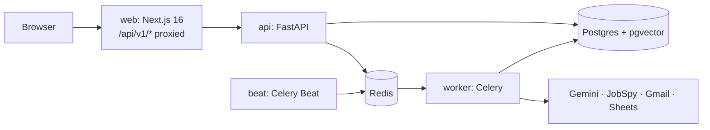

# JobPilot AI

Upload a resume, get fresh jobs from LinkedIn, Indeed, Glassdoor and Google ranked by fit with
an explained score, and prepare tailored applications that are only ever sent when you click
**Apply**.

> **Status:** Phase 1 (foundation) of 8. See [docs/PLAN.md](docs/PLAN.md) for the full plan.

## Architecture



- **Free stack:** Gemini free tier (LLM), fastembed (local embeddings), JobSpy (scraping),
  everything else self-hosted in Docker. See [PLAN §25](docs/PLAN.md#25-zero-cost-stack-build-and-run-for-free).
- **Auth:** backend-owned JWT + rotating refresh tokens in httpOnly cookies, same-origin via
  the Next.js proxy ([ADR 0001](docs/adr/0001-auth-in-backend.md)).

## Quick start (Windows, macOS, Linux)

Requirements: Docker Desktop, Python 3 (only to run the env script), Node 24 and
[uv](https://docs.astral.sh/uv/) if you want to run tools outside Docker.

```bash
python scripts/init_env.py
```

```bash
docker compose up -d --build
```

The frontend dev server runs on your machine, not in Docker (Next.js file watching is
unreliable through Docker mounts on Windows/macOS):

```bash
cd frontend && npm install && npm run dev
```

| URL | What |
|---|---|
| http://localhost:3000 | the app |
| http://localhost:8000/api/docs | API docs (Swagger) |
| http://localhost:8025 | Mailpit: verification and reset emails land here |

The API container runs `alembic upgrade head` on start.

**Low on RAM?** Docker Desktop's WSL VM keeps build caches in memory. Capping it leaves room
for the Next.js dev server: create `%UserProfile%\.wslconfig` with

```ini
[wsl2]
memory=4GB
```

then run `wsl --shutdown` and restart Docker Desktop.

### Try it

1. Open http://localhost:3000. You're redirected to `/login`.
2. **Create an account**, then open http://localhost:8025 and click the verification link.
3. Sign in. You land on `/onboarding`; the sidebar has Jobs, Applications, Dashboard, Settings.
4. In **Settings**, change your timezone or daily send cap and save.
5. Reload: you stay signed in. After 15 minutes the access token expires and is refreshed
   silently. Sign out from the avatar menu.

## Google sign-in (optional, free)

1. In [Google Cloud Console](https://console.cloud.google.com/) create a project, configure the
   OAuth consent screen (External, Testing) and add yourself as a test user.
2. Create an **OAuth client ID** (Web application) with the authorized redirect URI
   `http://localhost:3000/api/v1/auth/google/callback`.
3. Put the client ID and secret in `.env` (`GOOGLE_CLIENT_ID`, `GOOGLE_CLIENT_SECRET`), then
   `docker compose up -d api`. A **Continue with Google** button appears on the login page.

## Development

| Task | Command |
|---|---|
| Backend tests (in Docker) | `make test` |
| Backend tests (local, needs `docker compose up -d postgres redis`) | `cd backend && uv run pytest` |
| Lint + types | `make lint` |
| New migration | `make migration m="add something"` |
| Regenerate the typed API client | `make gen-api` |
| Celery dashboard | `docker compose --profile tools up -d flower` → http://localhost:5555 |

Without `make` on Windows, run the commands from the [Makefile](Makefile) directly.

## Project layout

```
backend/    FastAPI app, SQLAlchemy models, Alembic migrations, Celery tasks, tests
frontend/   Next.js app (App Router, Tailwind, shadcn/ui, TanStack Query, orval client)
docs/       PLAN.md, ADRs
scripts/    init_env.py
```

## Environment variables

All variables are listed with comments in [.env.example](.env.example). The ones you must
set are generated by `scripts/init_env.py`: `SECRET_KEY`, `ENCRYPTION_KEYS` (Fernet keys,
comma-separated, first one encrypts) and `FILE_MASTER_KEY`. **Back up `.env`**: losing the
encryption keys makes stored resumes and tokens unreadable.
