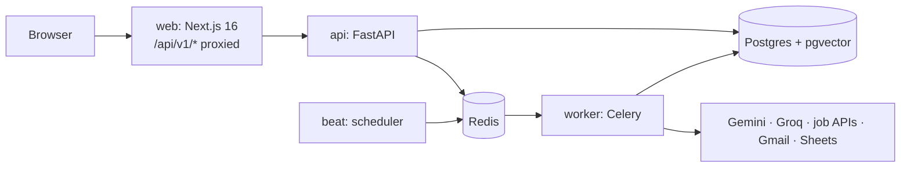

# JobPilot AI

Upload your resume and JobPilot finds fresh jobs and internships, ranks them by how well they
fit you (with the reasons), and helps you apply: a tailored email and cover letter written
only from facts on your resume, then a tracker from *saved* to *offer*. Nothing is ever sent or
submitted for you: you review every draft and click yourself.

It runs on free tiers: Gemini and Groq for AI, local embeddings, free job APIs, and your own
computer or a free cloud VM.

## What it does

| | |
|---|---|
| **Resume** | Upload a PDF/DOCX; AI turns it into an editable profile. Files are encrypted at rest. |
| **Find jobs** | Searches free job APIs (Arbeitnow, Remotive, Jooble, Adzuna, optional SerpAPI) for jobs or internships, by title and country/city. Optional scrapers (LinkedIn, Indeed…) are off by default. Duplicates are merged. Internships are labelled paid / unpaid. |
| **Match** | Filters out what you excluded, ranks the rest by similarity to your resume, and has AI score the best 15 (skills, experience, seniority, domain, location) with red flags and a plain-language reason. |
| **Apply** | Finds a contact email, writes an email and cover letter from a *fact sheet* of your resume, and flags any number, skill or degree that isn't on it. You copy the email, open it in your mail app, or apply on the company site with a checklist. |
| **Track** | Drag-and-drop board (Saved → Applied → Replied → Interview → Offer / Rejected), timelines, follow-up reminders and AI follow-up drafts, a dashboard with your funnel and the skills to learn next. |
| **Automate** | A daily search at your chosen hour with an email digest of new strong matches, and a Google Sheets tracker that updates itself. |
| **Your data** | Export everything as a zip, or delete your account and all its data. |

Not built yet: sending from the app through Gmail (you send from your own inbox) and
detecting Gmail replies automatically (you move the card to *Replied*).

## Architecture



- **Backend:** FastAPI, SQLAlchemy 2, Alembic, Celery + Redis, Postgres with pgvector,
  fastembed (local embeddings). AI behind one interface: Gemini, Groq, Ollama or Claude.
- **Frontend:** Next.js 16 (App Router), Tailwind, shadcn/ui, TanStack Query with a typed
  client generated from the API (orval).
- **Security:** auth cookies are httpOnly, same-origin and CSRF-protected; refresh tokens rotate
  with reuse detection ([ADR 0001](docs/adr/0001-auth-in-backend.md)); resume files and tokens
  are encrypted; logs never contain resume text or secrets; CSP and rate limits everywhere.

The full design is in [docs/PLAN.md](docs/PLAN.md).

## Quick start

Requirements: Docker Desktop, Python 3, Node 24, and [uv](https://docs.astral.sh/uv/).

```bash
python scripts/init_env.py
```

That creates `.env` with fresh secrets. Add a free Gemini key from
<https://aistudio.google.com/apikey> as `GEMINI_API_KEY` (see [API keys](#api-keys)), then:

```bash
docker compose up -d --build
```

```bash
cd frontend && npm install && npm run dev
```

| URL | What |
|---|---|
| http://localhost:3000 | the app |
| http://localhost:8000/api/docs | API docs |
| http://localhost:8025 | Mailpit: verification emails and digests land here |

Create an account, click the link in Mailpit, upload your resume, set your preferences and
click **Find jobs**.

### Low-memory mode (no backend Docker build)

Building the backend image needs a lot of RAM. On a tight machine, run only the data services
in Docker and the Python processes directly:

```bash
docker compose up -d postgres redis mailpit
```

```bash
cp backend/.env.host.example backend/.env.host
```

Then, in `backend/`, one terminal each for the API, the worker and (optionally, for daily
searches and digests) the scheduler:

```bash
uv run --env-file ../.env --env-file .env.host uvicorn app.main:app --port 8000 --reload
```

```bash
uv run --env-file ../.env --env-file .env.host celery -A app.tasks.celery_app worker -P solo -Q default,scrape,llm,email,sync -l info
```

```bash
uv run --env-file ../.env --env-file .env.host celery -A app.tasks.celery_app beat -l info -s ../data/celerybeat-schedule
```

On Windows, capping Docker's memory helps: create `%UserProfile%\.wslconfig` with
`[wsl2]` and `memory=4GB`, then run `wsl --shutdown` and restart Docker Desktop.

## API keys

All free. Put them in `.env` and restart the API and worker.

| Key | What for | Where |
|---|---|---|
| `GEMINI_API_KEY` | Reading resumes, scoring matches, fact-checking (required) | <https://aistudio.google.com/apikey> |
| `GROQ_API_KEY` + `WRITING_LLM_PROVIDER=groq` | Writing emails and cover letters (better than free Gemini) | <https://console.groq.com> |
| `JOOBLE_API_KEY` | More jobs, including Pakistan | <https://jooble.org/api/about> |
| `ADZUNA_APP_ID`, `ADZUNA_APP_KEY` | Jobs in 19 countries, with salaries | <https://developer.adzuna.com> |
| `GOOGLE_CLIENT_ID`, `GOOGLE_CLIENT_SECRET` | Google sign-in, Gmail, Sheets | Google Cloud Console (below) |
| `HUNTER_API_KEY` | Finding recruiter emails when a post has none (25/month) | <https://hunter.io> |

### Google (sign-in, Gmail, Sheets)

1. In [Google Cloud Console](https://console.cloud.google.com/) create a project. Enable the
   **Gmail API** and **Google Sheets API**.
2. **OAuth consent screen**: External, Testing; add your Gmail as a **test user**; add the
   scopes `openid`, `.../auth/userinfo.email`, `.../auth/userinfo.profile`,
   `.../auth/gmail.send` and `.../auth/drive.file`.
3. **Credentials → OAuth client ID** (Web application) with these redirect URIs:

   ```
   http://localhost:3000/api/v1/auth/google/callback
   http://localhost:3000/api/v1/integrations/gmail/callback
   http://localhost:3000/api/v1/integrations/sheets/callback
   ```

4. Put the client ID and secret in `.env`. Then use **Continue with Google** on the login page,
   and **Settings → Connect Gmail / Connect Google Sheets**.

## Deploying for free

One Oracle Cloud *Always Free* VM runs the backend with
[docker-compose.prod.yml](docker-compose.prod.yml), a Cloudflare Tunnel gives it HTTPS, and
the website runs on Vercel. Step by step: [docs/DEPLOY.md](docs/DEPLOY.md). Operations
(updates, logs, backups, key rotation): [docs/RUNBOOK.md](docs/RUNBOOK.md).

## Development

| Task | Command |
|---|---|
| Backend tests (needs postgres + redis running) | `cd backend && uv run --env-file ../.env --env-file .env.host pytest` |
| Lint + types | `make lint` |
| New migration | `make migration m="add something"` |
| Regenerate the typed API client | `make gen-api` |
| Rotate encryption keys | `cd backend && uv run python scripts/rotate_keys.py` ([how](docs/RUNBOOK.md#rotate-encryption-keys)) |

Without `make` on Windows, run the commands from the [Makefile](Makefile) directly. CI runs
lint, types, tests (coverage must stay above 80%), the frontend build, and checks the typed
API client matches the API.

## Project layout

```
backend/    FastAPI app, models, migrations, Celery tasks, prompts, tests
frontend/   Next.js app (App Router, Tailwind, shadcn/ui, TanStack Query, orval client)
docs/       PLAN.md, DEPLOY.md, RUNBOOK.md, ADRs
scripts/    init_env.py, backup.sh
```

## Environment variables

Every variable is listed with comments in [.env.example](.env.example) (development) and
[.env.production.example](.env.production.example) (production). `scripts/init_env.py`
generates the secrets: `SECRET_KEY`, `ENCRYPTION_KEYS` and `FILE_MASTER_KEY`. **Keep a copy of
the encryption keys**: without them stored resumes and tokens can't be read, even from a
backup.

## Responsible use

JobPilot never sends an email or submits a form without your click, never logs in to job
boards, and keeps a daily send cap. Job sources are read from public listings and may break
without notice; you're responsible for following each site's terms.
