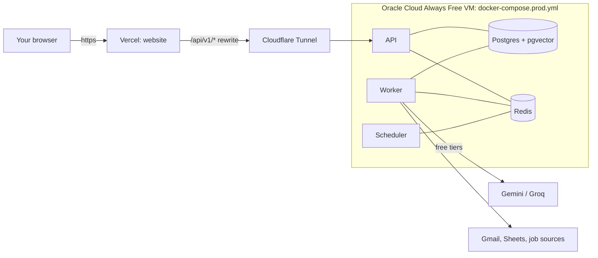

# Deploying JobPilot AI for free

The setup that costs **$0** and stays on all the time:



- **Website** on Vercel (Hobby plan, free for personal use). The browser only talks to the
  website; `/api/v1/*` is forwarded to the API, so login cookies stay first-party.
- **Everything else** on one Oracle Cloud *Always Free* ARM VM with Docker: API, worker,
  scheduler, Postgres, Redis.
- **HTTPS** through a Cloudflare Tunnel: the VM connects out to Cloudflare, so no ports are
  opened and no certificates need managing.

Budget an hour the first time.

---

## 1. The VM (Oracle Cloud Always Free)

1. Create an account at <https://www.oracle.com/cloud/free/>. It asks for a card to verify
   identity; *Always Free* resources aren't charged.
2. **Compute → Instances → Create instance**:
   - Image: **Ubuntu 24.04**. Shape: **Ampere (VM.Standard.A1.Flex)**, 2 OCPUs, 12 GB RAM
     (inside the free allowance of 4 OCPUs / 24 GB).
   - Add your SSH public key. Keep the default boot volume (≥ 50 GB).
   - No ingress rules are needed: the tunnel is outbound only.
3. SSH in and install Docker:

   ```bash
   sudo apt-get update && sudo apt-get install -y docker.io docker-compose-v2 git
   sudo usermod -aG docker $USER && newgrp docker
   ```

> Oracle may reclaim *idle* free instances. The daily search and the scheduler keep it busy;
> if you don't use JobPilot for weeks, check the instance is still there.

## 2. The code and secrets

```bash
git clone https://github.com/Usman7576/JobPilot.git && cd JobPilot
python3 scripts/init_env.py --production   # creates .env.production with fresh secrets
nano .env.production                        # fill in every <...>
```

Generate new secrets for production; never reuse the development ones. Keep a copy of
`ENCRYPTION_KEYS` and `FILE_MASTER_KEY` somewhere safe (a password manager): without them the
stored data and resume files can't be decrypted, even from a backup.

## 3. HTTPS with a Cloudflare Tunnel

You need a domain on Cloudflare (a free account; the domain itself can be any you own).

1. Cloudflare dashboard → **Zero Trust → Networks → Tunnels → Create a tunnel →
   Cloudflared**. Name it `jobpilot`. Copy the **token** into `CLOUDFLARE_TUNNEL_TOKEN`.
2. **Public hostname**: `api.<your-domain>` → service **HTTP** → `api:8000`.
3. Start the stack:

   ```bash
   docker compose -f docker-compose.prod.yml --env-file .env.production up -d --build
   docker compose -f docker-compose.prod.yml --env-file .env.production ps
   curl https://api.<your-domain>/api/v1/health/ready      # {"status":"ok",...}
   ```

   The first build downloads the AI embedding model (about 400 MB) and takes a while on ARM.
   Migrations run automatically when the API starts.

## 4. The website on Vercel

1. <https://vercel.com> → **Add New → Project** → import the GitHub repo.
2. **Root Directory**: `frontend`. Framework: Next.js (detected).
3. **Environment variable**: `API_INTERNAL_URL` = `https://api.<your-domain>`.
4. Deploy. Your site is `https://<project>.vercel.app` (or add your own domain in Vercel).
5. Put that address in `.env.production` as `APP_BASE_URL`, then
   `docker compose -f docker-compose.prod.yml --env-file .env.production up -d`.

## 5. Google sign-in, Gmail and Sheets

In Google Cloud Console → your OAuth client, add the production redirect URIs (same host as
`APP_BASE_URL`):

```
https://<your-site>/api/v1/auth/google/callback
https://<your-site>/api/v1/integrations/gmail/callback
https://<your-site>/api/v1/integrations/sheets/callback
```

and the website under **Authorized JavaScript origins**. While the app is in *Testing* mode,
only the test users you list can sign in, and Gmail/Sheets access must be reconnected every
7 days. Publishing the app for everyone requires Google's verification.

## 6. Email for accounts

Verification links, password resets and the daily digest need real email. Free options:

- **Gmail SMTP**: turn on 2-step verification, create an *app password*, then
  `SMTP_URL=smtp+starttls://you%40gmail.com:<app-password>@smtp.gmail.com:587`.
- **Resend** (free tier): `SMTP_URL=smtps://resend:<api-key>@smtp.resend.com:465`, with your
  domain verified in Resend.

## 7. Backups

```bash
crontab -e
# every night at 03:15 UTC, keeps 14 days:
15 3 * * * cd /home/ubuntu/JobPilot && sh scripts/backup.sh >> data/backups/backup.log 2>&1
```

Copy `data/backups/` off the VM now and then (for example with `rclone` to a free cloud drive).

## 8. Checklist before you share the link

- [ ] `.env.production` has fresh secrets, and a copy of the keys is stored safely.
- [ ] `curl https://api.<your-domain>/api/v1/health/ready` returns ok.
- [ ] Signing up sends a real verification email.
- [ ] Google sign-in, Gmail and Sheets connect on the production address.
- [ ] A search finds and scores jobs; the worker and scheduler logs show no errors:
      `docker compose -f docker-compose.prod.yml --env-file .env.production logs -f worker beat`.
- [ ] The nightly backup ran (`data/backups/backup.log`).

Day-to-day operations (updates, logs, restores, key rotation) are in
[RUNBOOK.md](RUNBOOK.md).
